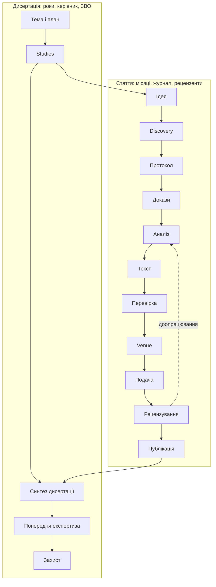

# Крок 2.5 — Життєвий цикл наукової статті та дисертації

Дата: 2026-10-27, редакція 2 (додано §3А — обов'язковий intake-опитувальник і профілі правил за рішенням автора). Статус: **погоджено автором 2026-10-27** (рішення — §14). Крок етапу 0 за `stage-0/00-stage0-plan.md`.
Вхід: `03-workflow.md`, `06-contracts.md`, `11-vision-addendum-2026-10-20.md` §5–8, `12-reuse-registry-verified-2026-10-27.md`, актуальні нормативні джерела (див. «Джерела»).
Старі файли спеки не переписуються; зміни, які випливають звідси, передаються в крок 3 (§12).

**Позначки достовірності:**
- **[Н]** — нормативний або зовнішній факт із джерелом (перевірено 2026-10-27);
- **[Н?]** — факт із вторинних джерел, первинний текст не прочитано; перевірити перед використанням у профілі;
- **[С]** — уже зафіксовано в спеці v0.1 / addendum;
- **[П]** — пропозиція цього кроку, потребує погодження.

---

## 0. Мета і межі

Мета — описати, **як створюються наукова стаття і дисертація**, на рівні етапів, артефактів, перевірок і власників рішень, щоб потім автоматизувати й валідувати кожен етап. Це не дизайн конкретної статті автора.

Перший реальний кейс використано лише як профіль-приклад для перевірки повноти циклу (§11).

Поза межами: юридичні висновки; перелік вимог конкретного ЗВО чи журналу (це versioned profiles, які заповнюються під кейс); виконання дій за людину (подача, етична комісія, офіційна перевірка на плагіат).

## 1. Головні висновки

1. **Три вкладені цикли, а не один.** [П] Дослідження (study) → публікація (article) → дисертація (thesis). Spec v0.1 описує фактично лише цикл study + підготовку рукопису й зупиняється на `Package/G3`. Реальна стаття продовжується після подачі: рецензування, доопрацювання, прийняття, публікація, використання в дисертації.
2. **`study_kind` ширший, ніж емпіричне ML-дослідження.** [П] Для освітніх наук типові огляди, концептуальні/теоретичні статті, опитування, інтерв'ю, педагогічний експеримент. Контракт `Run/ResultRow` — лише один вид доказової бази; потрібна узагальнена модель «отримання доказів» із підтипами.
3. **Перший кейс не проходить шлях MVP v0.1.** [П] Кейс — стаття для дисертації в освітніх науках, `create`, лише тема, без учасників. Тобто основна робота — Discovery, позиціонування, синтез, аргумент. «Import results» не задіяний. Це суперечність зі scope MVP (§12, рядок 1).
4. **Venue — окремий першокласний об'єкт.** [Н] Новий Перелік фахових видань кат. «Б» діє з 1.06.2026 до 1.06.2029; критерії журналів включають DOI, ORCID, відкритий доступ, прозоре рецензування і **політику щодо використання ШІ**. Вимоги журналу треба зберігати як versioned profile з датою перевірки.
5. **Дисертаційні правила впливають на кожну статтю.** [Н]/[Н?] Мінімум три публікації; співавторство >2 осіб зменшує зарахування; з жовтня 2026 публікації із самоплагіатом не зараховуються, а нестача публікацій після цього веде до відмови без права повторного подання. Harness потрібна перевірка перетину між власними текстами автора та облік публікаційного плану.
6. **Доброчесність — довгостроковий ризик.** [Н?] За новими правилами ступеня можуть позбавити за плагіат, фабрикацію чи фальсифікацію незалежно від часу після захисту. Отже provenance-пакет кожної статті — архівний артефакт на роки, а не тимчасовий звіт.
7. **Людина вирішує, система готує і перевіряє.** [С]/[П] Наукові рішення, подача, етика, відповідь рецензентам по суті — за людиною; детерміновані перевірки — за CLI; семантичні оцінки — advisory від ролей analyst/critic.
8. **Intake-опитувальник і профілі правил — обов'язковий вхід у систему.** [Рішення автора 2026-10-27] Harness — універсальний каркас; знання про країну, регулятора, клас видання, журнал і установу живуть у versioned rule packs, а не в коді чи промптах. Без пройденого intake стаття не стартує (§3А).

## 2. Модель: три вкладені цикли



| Рівень | Горизонт | Головний об'єкт | Зовнішні учасники | Що фіксує результат |
|---|---|---|---|---|
| Study | тижні–місяці | питання + протокол + докази | етична комісія (умовно) | evidence map, results / synthesis |
| Article | місяці | рукопис для конкретного venue | редакція, рецензенти, співавтори | publication record (DOI, випуск) |
| Thesis | 4 роки ОНП | дослідницька лінія і внесок | керівник, кафедра, вчена рада, разова рада, НАЗЯВО | захищена дисертація, архів доказів |

[П] Одна study може дати кілька статей і розділ дисертації; одна стаття може спиратися на кілька studies. Зв'язки зберігаються ID, не копіюванням тексту.

---

## 3. Життєвий цикл статті

Позначення перевірок: **Д** — детермінована (CLI, без LLM); **С** — семантична (модель/critic, advisory, з підставами й невизначеністю); **Л** — людське рішення.

### 3.1. Етапи: входи і виходи

| ID | Етап | Мета | Вхід | Вихід (артефакти) |
|---|---|---|---|---|
| A0 | Intake (обов'язковий, §3А) | Опитувальник → контекст статті → набір правил | Запит автора; відповіді на опитувальник; надані матеріали; thesis intake, якщо стаття для дисертації | `intake.json`, `materials/manifest.json`, `profiles/resolved-stack.json` (застосовані rule packs із версіями), список невідомого з наслідками, `brief.md` |
| A1 | Оцінка ідеї | Вирішити pursue / refine / kill до витрат на текст | Brief; 5–10 ключових джерел першого огляду | Idea assessment: питання, значущість, ризик дублювання, рішення автора з причиною |
| A2 | Discovery | Знайти релевантні й суперечливі роботи з provenance | Search plan; `source-policy.yaml`; seed-джерела | Search log (запит, ресурс, дата, статус доступу), source registry, excerpts із locator, exclusions з причинами, список прогалин |
| A3 | Позиціонування | Сформулювати прогалину і внесок | Registry, excerpts, прогалини | Contribution map; gap statement з evidence refs; твердження про новизну як claims |
| A4 | Дизайн / протокол | Визначити, як відповідатимемо на питання | A3; варіанти `study_kind` (§4) | Protocol vN за study_kind; план аналізу; умови спростування / критерії завершення |
| A5 | Етика і дані *(умовний)* | Законність і етичність збору даних | Protocol; опис учасників | Етичний пакет (згоди, план управління даними, анонімізація); запис рішення комісії |
| A6 | Отримання доказів | Зібрати доказову базу за протоколом | Protocol; доступи; дозволи | Runs / datasets / extraction matrix із provenance; журнал відхилень від протоколу |
| A7 | Аналіз та інтерпретація | Визначити, що підтримують докази, і межі висновків | Докази A6 | Result rows / таблиця синтезу / codebook і теми; limitations; альтернативні пояснення |
| A8 | Аргумент і план | Структура статті під venue | Claims; venue profile | Claim ledger (material claims), outline, section briefs, план рисунків і таблиць |
| A9 | Написання розділів | Текст за брифами | Section brief; author profile | Section drafts з claim refs; позначені placeholders для прогалин |
| A10 | Інтеграція | Цілісність рукопису | Прийняті розділи | Інтегрований рукопис; `reviews/integration.md` |
| A11 | Внутрішня перевірка і доброчесність | Знайти дефекти до подачі | Snapshot рукопису + evidence | Findings, coverage report, звіт перетину з власними публікаціями, AI-use record, CRediT |
| A12 | Підготовка до venue | Відповідність вимогам журналу | Venue profile; рукопис | Відформатований рукопис (анотації UA/EN, ключові слова, стиль посилань), checklist venue, чернетка cover letter |
| A13 | Подача | Передати журналу | Verified bundle | Submission record: дата, журнал, ID рукопису, версія (hash). **Дію виконує людина** |
| A14 | Рецензування і доопрацювання | Відповісти на рецензії | Рецензії; подана версія | Таблиця comment → action → location → evidence → response; нова версія + diff |
| A15 | Прийняття і публікація | Зафіксувати version of record | Лист про прийняття; коректура | Publication record (DOI, випуск, дата, ліцензія, URL); перевірка коректури |
| A16 | Після публікації | Використання і виправлення; повернення до статті будь-коли на запит автора (§3.4) | Publication record; повна історія статті | Зв'язок із thesis index; errata; реєстр самоцитувань і перетинів |

### 3.2. Етапи: перевірки, власники, ролі, gates

| ID | Д — детерміновані | С — семантичні (advisory) | Л — людське рішення | Власник рішення | Ролі | Gate |
|---|---|---|---|---|---|---|
| A0 | Обов'язкові поля опитувальника заповнені або `unknown` з наслідками; hashes матеріалів; стек профілів розв'язано без конфліктів; правила мають `checked_at` у межах терміну | Класифікація режиму і scope; витяг контексту з наданих матеріалів | Підтвердити підсумок intake | Автор | Orchestrator | **G0** [П] — intake complete |
| A1 | Є decision record з причиною | Значущість, ризик дублювання (scooping), реалістичність | Pursue / refine / kill | Автор (+ керівник для дисертаційної статті) | Planner, Critic | Decision record (не hash-gate) |
| A2 | Повнота query log; `unavailable` ≠ «нічого не знайдено»; metadata_status; дедуплікація; retraction status; excerpt має locator | Relevance triage; пошук контрдоказів | Межі теми; які ключові джерела автор читає сам | Автор — межі; система — повнота журналу | Researcher | — |
| A3 | Кожне твердження про новизну має evidence refs | Чи прогалина справді не закрита | Погодити внесок | Автор | Planner, Analyst, Critic | — |
| A4 | Schema протоколу за study_kind; обов'язкові поля; версія | Валідність дизайну; чи можна спростувати | Схвалити питання і протокол | Автор (+ керівник) | Planner, Analyst | **G1** [С] |
| A5 | Якщо `participants=true` — є запис зовнішнього рішення | Ризики: неповнолітні, персональні дані | Етичне схвалення | Етична комісія / установа | Analyst | **GE** [П], зовнішній |
| A6 | Provenance кожного доказу; hashes; виявлення відхилень від протоколу | Якість extraction / даних | Схвалити суттєві відхилення | Автор | Researcher, Analyst | **G2** [С] |
| A7 | Tuple-перевірка чисел; перерахунок; одиниці | Інтерпретація, альтернативні пояснення, limitations | Ключова інтерпретація | Автор | Analyst, Critic | — |
| A8 | Кожен material claim має evidence або result_ref; outline покриває обов'язкові розділи venue | Сила твердження ↔ докази | Погодити outline | Автор | Planner, Writer | — |
| A9 | Лише відомі cite keys; числа через renderer; placeholders позначені; locked sections не змінені | Section review проти brief; стиль автора не змінює qualifiers | Правки автора (через diff) | Автор | Writer, Critic | — |
| A10 | Термінологія, позначення, нумерація рисунків, cite keys; числа в анотації = числа в результатах | Суперечності анотація ↔ результати ↔ висновки | — | Система; автор розв'язує findings | Critic (integrator) | — |
| A11 | Існування джерел; support coverage з явним знаменником; stale checks; перетин із власними публікаціями; відсутність секретів | Support verdict для кожного місця цитування; симуляція рецензії | Рішення по кожному finding (прийняти / відхилити з причиною) | Автор | Critic | — |
| A12 | Checklist venue: структура, обсяг, анотації UA/EN, ключові слова, стиль посилань, ORCID, заява про використання ШІ | Відповідність тематиці журналу | Схвалити версію для подачі | Автор (+ співавтори, керівник) | Orchestrator, Writer | **G3** [С] |
| A13 | Manifest bundle; hash поданої версії | — | Подати | Автор | — | — |
| A14 | Кожен коментар має action / location / response; diff лише в заявлених місцях; stale propagation | Адекватність відповіді; аргументи незгоди | Згода чи незгода з рецензентом; G3 нової версії | Автор | Writer, Analyst, Critic | **G3** (новий hash) |
| A15 | Diff коректури проти схваленої версії; DOI резолвиться; metadata збігаються | — | Схвалити коректуру | Автор | — | — |
| A16 | Зв'язок із thesis index; реєстр перетинів | — | — | Система | Orchestrator | — |

### 3.3. Повернення назад

Повернення — нормальний шлях, не помилка. [С] Новий протокол не переписує історію старого.

| Тригер | Повертаємось до | Що стає stale |
|---|---|---|
| Нові джерела закривають заявлену прогалину | A3 | Contribution map, claims новизни, анотація |
| Дані неможливо зібрати за протоколом | A4 | Protocol (нова версія), G1 при зміні primary metric / критеріїв |
| Негативний результат | A3 / A8 | Позиціонування, outline; результат зберігається |
| Contradicted claim у перевірці | A7 або A9 | Залежні розділи, G3 |
| Журнал вимагає іншу структуру | A8 | Outline, section briefs |
| Рецензент просить додатковий аналіз | A6 / A7 | Result rows, залежні claims; G2 при відхиленні |
| Відмова журналу | A12 з іншим venue profile | Форматування, G3 |
| Змінено ціль публікації (країна, клас видання, журнал, мова) | A0 → повторне розв'язання стеку профілів | Усі перевірки, що залежать від змінених правил: структура, обсяг, стиль посилань, мова, A12, G3 |
| Rule pack застарів (минув `valid_to` або термін перевірки) | A0 (оновлення профілю) | Перевірки, які спираються на це правило; до оновлення — `unknown`, не PASS |
| Коректура змінила зміст | A11 | Д-перевірки змінених місць |

### 3.4. Стаття — довгоживучий об'єкт

Рішення автора (2026-10-27). Стаття не закривається після публікації чи відмови: до неї можна повернутися будь-коли — доопрацювати, відповісти на питання рецензента чи читача, підготувати нову версію, використати в дисертації.

| Властивість | Як працює |
|---|---|
| Необмежений час життя | Статус статті не є кінцевим; A16 — стан очікування, а не завершення |
| Історія — частина статті | Усі snapshots, подачі, рецензії, відповіді, рішення і publication records зберігаються в проєкті й доступні при поверненні. Історію не треба вводити заново в опитувальнику |
| Повернення | Будь-яким режимом: `revise`, `extend`, `respond_to_reviewers`. Intake скорочений: система показує поточний стан і питає лише про мету повернення |
| Жодних змін без прямого запиту | Система не змінює статтю, не нагадує про неї, не перевіряє її статус і не пропонує доопрацювань, поки автор сам не звернувся з конкретною вимогою |
| Незмінність минулого | Попередні версії і подані snapshots не переписуються; нова робота створює нову версію з diff |
| Застарілі правила | При поверненні стек профілів розв'язується заново: правила могли змінитися з моменту публікації (§3А.5) |

---

## 3А. Обов'язковий intake: опитувальник і профілі правил

Рішення автора (2026-10-27): перед кожною статтею і дисертацією користувач проходить короткий опитувальник; за відповідями система обирає набір правил; каркас не прив'язаний до однієї країни чи галузі. Деталізація нижче — [П].

### 3А.1. Принципи

1. **Каркас універсальний, знання — у даних.** Вимоги України, ЄС, Scopus, конкретного журналу чи ЗВО — це rule packs із джерелом і датою перевірки. Код і промпти не містять правил конкретної країни.
2. **Intake обов'язковий.** Для `create` і `extend` — повний; для `revise` і `respond_to_reviewers` — скорочений: більшість відповідей виводиться з наданого рукопису й рецензій, питання ставляться лише про те, чого бракує.
3. **Не питати двічі.** Відповіді попередніх intake (автор, ORCID, установа, thesis intake) підставляються як значення за замовчуванням; користувач лише підтверджує або змінює.
4. **«Не знаю» — допустима відповідь.** Вона зберігається як `unknown` із показаним наслідком: який етап буде заблоковано або яка перевірка залишиться `unknown`. Приклад: без цільового venue можна працювати A1–A11, але A12 і G3 заблоковані.
5. **Правило без джерела — не правило.** Кожне правило має джерело, дату перевірки і рівень достовірності ([Н] / [Н?]). Застаріле правило дає `unknown`, а не PASS.

### 3А.2. Опитувальник

Ядро — до 10 питань; решта з'являється лише за умовами.

| Блок | Питання | Умова | На що впливає |
|---|---|---|---|
| Q1. Документ | Тип: стаття / розділ дисертації / дисертація / тези / звіт; режим: create / revise / extend / respond_to_reviewers | Завжди | Цикл, стартовий етап (§5) |
| Q2. Тема | Тема, робоче питання, ключові слова; чи частина дисертації (яке завдання / study) | Завжди | Brief, A1, зв'язок із thesis index |
| Q3. Матеріали | Що є: нічого / джерела / дані / код / чернетка / рецензії / нотатки | Завжди | Стартовий етап, Discovery |
| Q3a. Надання матеріалів | Як надати: файли в папку проєкту; BibTeX / RIS (експорт Zotero, Mendeley); список DOI або посилань; рукопис (.docx, .md, .tex); дані (CSV / XLSX); посилання на git-репозиторій; підключений сервіс (наприклад Google Drive) | Якщо Q3 ≠ нічого | `materials/manifest.json` з hash і походженням |
| Q3b. Дозволи на матеріали | Чи можна передавати матеріали зовнішнім API; чи є персональні або чутливі дані; чи є неопубліковані дані співавторів | Якщо є дані або чернетка | Політика зовнішніх викликів, приватність export (FR-16, NFR-06) |
| Q4. Публікація | Країна або регулятор, для якого важливе зарахування (Україна / ЄС / інше / неважливо); клас видання (фахове кат. «Б» / Scopus / Web of Science / proceedings / інше / ще не знаю); конкретний журнал, якщо є; мова(и) | Завжди | Вибір rule packs (§3А.3), структура, A12 |
| Q4a. Умови публікації | Дедлайн; бюджет на APC (плату за публікацію); вимога відкритого доступу | Якщо журнал або клас відомі | Вибір venue, план |
| Q5. Автор і попередні публікації | ORCID або список власних публікацій; чи спирається стаття на попередні роботи; чи бажає посилатись на власні праці | Завжди (підставляється з попередніх intake) | Реєстр перетинів, самоцитування, перевірка самоплагіату (A11) |
| Q5a. Співавтори | Хто співавтори, ролі (CRediT), хто відповідальний автор | Якщо є співавтори | Зарахування публікацій, CRediT, approvals |
| Q6. Інституційний контекст | ЗВО, спеціальність, керівник; скільки публікацій уже зараховано; локальне положення про ШІ | Якщо стаття для дисертації або звітності | Institution profile, публікаційний план |
| Q7. Етика | Чи є учасники; чи є неповнолітні; чи є вже етичне схвалення | Якщо study_kind емпіричний або невідомий | GE |
| Q8. Стиль і ШІ | Зразки власних текстів або вподобання; які частини роботи дозволено робити з ШІ за правилами установи / журналу | Перший раз; далі — з профілю | Author profile, AI-use record |
| Q9. Обмеження | Час, доступ до платних баз, бюджет на сесію | Опційно | Budget controller, source policy |
| Q10. Рівень автономії агента | Як часто зупинятися на перевірку: покроково / на gates / пакетно (§3А.7) | Завжди (за замовчуванням — з профілю автора) | Коли агент зупиняється і питає |

### 3А.3. Профілі правил і їх композиція

Стек профілів формується з відповідей Q1–Q8. Шари — від загального до конкретного:

| # | Шар | Приклади rule packs | Що визначає |
|---|---|---|---|
| 0 | core | `core` | Незмінні інваріанти: без вигаданих даних і джерел, provenance, unknown ≠ PASS, AI-use record |
| 1 | document_kind | `article`, `thesis`, `conference-abstract`, `review-article` | Набір етапів, обов'язкові частини |
| 2 | study_kind і галузеві стандарти звітування | `literature-narrative`, `scoping-review` (PRISMA-ScR), `qualitative` (COREQ / JARS-Qual), `ml-empirical` | Протокол, перевірки A4–A7 |
| 3 | регулятор / юрисдикція | `ua-mon-phd`, `ua-mon-perelik`, `eu-…`, `none` | Зарахування публікацій, самоплагіат, вимоги до дисертації |
| 4 | клас видання | `ua-fahove-b`, `scopus-indexed`, `wos-indexed`, `proceedings` | Перевірка статусу видання на дату, типові вимоги класу, ризик хижацьких журналів |
| 5 | конкретне видання | `journal:<ISSN>` | Author guidelines: структура, обсяг, анотації, стиль посилань, політика ШІ, APC |
| 6 | установа | `inst:<ЗВО>`, `onp:<програма>` | Локальні положення, оформлення, ОНП |
| 7 | автор / проєкт | `author:<id>` | Мова, стиль, вподобання |

**Правила композиції:**
- **Форма і структура** (обсяг, порядок розділів, стиль посилань, мова): виграє конкретніший шар — журнал важливіший за клас видання.
- **Доброчесність і зарахування** (самоплагіат, співавторство, статус журналу): застосовуються всі правила разом, діє найсуворіше.
- **core** не перевизначається жодним шаром.
- Конфлікт, який не розв'язується цими правилами, — finding для автора на A0, а не мовчазний вибір системи.

Важливо: Scopus і Web of Science — бази індексування, а не автори вимог до статей. Шар 4 перевіряє, що журнал індексується на дату публікації; вимоги до тексту приходять із шару 5 — author guidelines журналу.

### 3А.4. Формат правила (ілюстрація, не фінальна schema)

```yaml
id: UA-PHD-SELFPLAG-01
pack: ua-mon-phd
version: 2026-10-27
kind: integrity            # integrity | counting | structure | format | process
applies_to: [A11, T7]
check: deterministic+human # Д виявляє перетин, Л вирішує
severity: blocker          # для зарахування в дисертацію
statement: >
  Публікація, у якій встановлено самоплагіат, не зараховується за темою дисертації.
source:
  title: Постанова КМУ № 1240 від 07.10.2026 (зміни до постанови № 44)
  url: <посилання на офіційний текст>
  evidence_level: Н?        # первинний текст ще не прочитано
checked_at: 2026-10-27
valid_from: 2026-10-07
review_after: 2027-04-27
```

### 3А.5. Життєвий цикл rule pack

1. **Створення.** Агент досліджує вимоги (офіційні джерела, author guidelines) і створює pack зі статусом `draft`; кожне правило — з джерелом.
2. **Перевірка.** Автор або агент звіряє з першоджерелом; статус `verified` з датою. [Н?]-правила не можуть бути blocker без перевірки — лише warning.
3. **Використання.** Розв'язаний стек фіксується в `profiles/resolved-stack.json` з версіями packs; зміна версії робить залежні перевірки stale.
4. **Повторна перевірка.** Перед G3 (A12) і перед захистом (T7) — обов'язкова перевірка актуальності шарів 3–6. Нормативи змінюються: постанова № 1240 з'явилася за два тижні до цього документа.
5. **Бібліотека packs.** Packs зберігаються в репозиторії harness окремо від статей і перевикористовуються між проєктами.

### 3А.6. Thesis intake

Дисертація має власний, одноразовий і довгоживучий intake на T0–T1: установа, спеціальність, ОНП, керівник, тема, вже зараховані публікації, публікаційний план. Intake кожної дисертаційної статті успадковує його, тож автор відповідає лише на питання про конкретну статтю.

### 3А.7. Рівень автономії агента

Обирається в Q10; можна змінити будь-коли; за замовчуванням береться з профілю автора.

| Рівень | Поведінка | Коли доречно |
|---|---|---|
| Покроковий | Зупинка після кожного етапу A0–A16 з підсумком і пропозицією наступного кроку | Перша стаття, нова галузь, навчання роботі з системою |
| На gates (за замовчуванням) | Агент самостійно проходить етапи між gates; зупиняється на Л-рішеннях і gates | Звичайна робота |
| Пакетний | Агент проходить кілька етапів, а питання до автора збирає в одну чергу | Довгі сесії, коли автор переглядає результат пізніше |

Інваріант для всіх рівнів: обов'язкові людські рішення (G0, G1, G2, G3, GE, рішення по findings) і зовнішні дії (подача, офіційна перевірка, етика) не пропускаються жодним рівнем автономії. Рівень визначає лише, як часто агент зупиняється між ними.

---

## 4. Варіанти за `study_kind`

Етапи A4, A6, A7 залежать від типу дослідження; решта циклу спільна. Рамки звітування — приклади, не обов'язкові стандарти; конкретний журнал може вимагати інше.

| study_kind | A4: протокол містить | A6: докази | A7: аналіз | Ключові Д-перевірки | Рамки звітування | Статус [П] |
|---|---|---|---|---|---|---|
| literature — narrative review | Питання, межі, описова стратегія пошуку, принцип відбору | Excerpts, матриця синтезу | Тематичний синтез, порівняння позицій | Кожне твердження огляду → excerpt; access level видно; не називати систематичним | — | **MVP** (перший кейс) |
| literature — scoping / systematic | PCC / PICO, бази, пошукові рядки, критерії включення, screening, оцінка якості (для systematic) | Screening records, лічильники потоку | Картування / синтез; ризик упереджень | Арифметика flow-діаграми; кожне включене джерело має рішення screening | PRISMA 2020, PRISMA-ScR | LATER (FR-15) |
| theoretical / conceptual | Визначення, припущення, структура аргументу | Визначення і позиції з джерел | Логічний аргумент, класифікації, моделі | Кожне засновання — з джерела або позначене як припущення; визначення вживаються узгоджено | — | **MVP** разом із literature |
| empirical — quantitative (опитування, педагогічний експеримент) | Гіпотези, інструмент і його версія, вибірка, групи, етапи експерименту, план аналізу | Dataset із provenance; версія анкети | Статистика | ResultRow tuple; n узгоджене; метод відповідає дизайну | APA JARS-Quant | Контракти є (узагальнити Run); пілот — пізніше |
| empirical — qualitative (інтерв'ю, фокус-групи) | Гайд, відбір учасників, підхід до кодування | Анонімізовані транскрипти, codebook | Тематичний аналіз | Цитата → locator у транскрипті; анонімізація | COREQ, APA JARS-Qual | LATER |
| empirical — computational (ML) | Як у v0.1 | Runs | Метрики | Tuple-валідатори | NeurIPS checklist | MVP v0.1 [С] |
| mixed | Комбінація | Комбінація | Інтеграція кількісного і якісного | Обидва набори | — | LATER |

[П] Педагогічний експеримент у вітчизняних освітніх науках зазвичай описується етапами (констатувальний, формувальний, контрольний). Це підтип quantitative / mixed; потребує GE, якщо учасники — діти.

## 5. Режими роботи

`operation_mode` не залежить від `document_kind`. [С]

| Режим | Тригер | Стартовий етап | Що заблоковано | Обов'язкові артефакти | Особливі перевірки |
|---|---|---|---|---|---|
| `create` | Лише тема або матеріали | A0 → A1 | — | intake, brief | Results не вигадуються (T01) |
| `revise` | Є рукопис + мета правки | A0 → import → погоджений scope → потрібний етап | Locked sections; все поза scope | `manuscript/original/`, change plan, `manuscript/diffs/` | Локальна правка не змінює locked (T21); перевірка affected claims і figures |
| `extend` | Є стаття / study, треба новий розділ, дані чи нова стаття на основі старої | A0 → A2 або A6 | Опублікований текст | Реєстр перетинів, посилання на попередні публікації | Перетин із власними публікаціями; повторне використання — лише з посиланням |
| `respond_to_reviewers` | Є рецензії | A14 | Все, що не зачіпають коментарі | Таблиця відповідей, diff | Кожен коментар закритий; незгода — з аргументами й evidence |

Рівень дисертації має ще операцію «стаття → розділ» (T6): це `extend` з адаптацією тексту, посиланням на власну публікацію і перевіркою узгодженості з іншими розділами.

---

## 6. Життєвий цикл дисертації

Дисертація — не «довга стаття». Вона має власний горизонт (нормативний строк ОНП), людей, які приймають рішення, нормативні вимоги і головний об'єкт — **дослідницьку лінію з доведеним внеском**, розподіленим між studies, публікаціями й розділами.

### 6.1. Нормативна рамка (Україна, PhD)

| Вимога | Що означає для harness | Позначка |
|---|---|---|
| Порядок присудження ступеня — постанова КМУ № 44 від 12.01.2022 (зі змінами) | Базовий профіль атестації | [Н] |
| Наукові результати висвітлені щонайменше в трьох наукових публікаціях; стаття з більш ніж двома співавторами рахується як 0,5 (з винятками) | Д-перевірка публікаційного плану | [Н] |
| Оформлення дисертації — наказ МОН № 40 від 12.01.2017 | Export profile дисертації | [Н] |
| Постанова КМУ № 1240 від 07.10.2026: публікації із самоплагіатом не зараховуються; якщо після цього публікацій менше мінімуму — відмова без права повторного подання; позбавлення ступеня за плагіат, фабрикацію, фальсифікацію незалежно від строку | Перевірка перетину власних текстів; архів provenance на роки | [Н] за МОН / Інтерфакс; первинний текст не прочитано |
| Там само (за вторинними джерелами): в одному випуску видання зараховується не більше однієї статті здобувача; уточнено вимоги до обґрунтування наукових результатів у статтях | Д-правило в публікаційному плані; уточнити зміст вимог | [Н?] |
| Висновок про наукову новизну, теоретичне і практичне значення — заява не пізніше ніж за 9 місяців до завершення нормативного строку (Порядок № 261, п. 25) | Дедлайн у thesis plan | [Н]; перевірити актуальну редакцію |
| Перелік фахових видань кат. «Б» — наказ МОН № 928 від 11.06.2026, чинний 1.06.2026–1.06.2029 | Venue profile має дату чинності; перевіряти включення на дату публікації | [Н] |
| Рекомендації МОН і Мінцифри щодо відповідального використання ШІ в ЗВО (оприлюднені 29.04.2025) | AI-use record для кожної статті і дисертації; локальні положення ЗВО — окремий профіль | [Н] |

[П] Усе це — **institution/regulation profile** із полями `source`, `version`, `checked_at`, а не жорстко прописані правила. Нормативи змінюються (зміна № 1240 — два тижні тому).

### 6.2. Етапи дисертації

| ID | Етап | Вхід | Вихід (артефакти) | Перевірки (Д / С / Л) | Власник рішення | Зовнішні учасники |
|---|---|---|---|---|---|---|
| T0 | Тема і керівник | Ідея, сфера, ОНП | Затверджена тема, керівник, запис рішення | Л; Д — запис має посилання на документ | Вчена рада | Керівник, вчена рада |
| T1 | Дослідницька програма | Тема; індивідуальний план | `thesis/index.json`: дослідницьке питання, завдання, карта studies → розділи → статті; публікаційний план | Д — кожне завдання має study; план ≥ мінімуму за правилами зарахування. С — логіка лінії. Л — погодження | Автор + керівник | Керівник |
| T2 | Спільна теоретична база | Literature studies | Спільний source registry; глосарій термінів і позначень | Д — терміни вживаються за глосарієм; С — повнота огляду | Автор | — |
| T3 | Studies і статті | Thesis index | Для кожної study — цикл A0–A16; publication records | Як у §3; Д — стаття прив'язана до study і завдання дисертації | Автор | Редакції, рецензенти |
| T4 | Апробація | Results studies | Записи конференцій, тези, доповіді | Д — облік; апробація окремо від зарахованих публікацій | Автор | Оргкомітети |
| T5 | Звітність і атестація | Стан артефактів | Семестрові / річні звіти, згенеровані зі стану studies і публікацій | Д — звіт відповідає стану; Л — автор редагує | Автор, кафедра | Кафедра, керівник |
| T6 | Синтез дисертації | Studies, статті, глосарій | Рукопис: вступ (актуальність, мета, завдання, об'єкт, предмет, методи, новизна, значення, апробація, публікації), розділи, висновки | Д — кожен пункт новизни ↔ study ↔ публікація ↔ розділ; посилання на власні публікації. С — узгодженість між розділами, висновки не виходять за докази | Автор + керівник | Керівник |
| T7 | Доброчесність і відповідність | Рукопис, публікації | Звіт перетинів, перевірка публікаційних правил, compliance з наказом № 40 і локальним положенням | Д — перетини, правила зарахування, оформлення. Л — офіційна перевірка в системі ЗВО | ЗВО | Відповідальний підрозділ |
| T8 | Попередня експертиза | Дисертація, публікації, висновок керівника | Висновок підрозділу; список зауважень | Л — зовнішнє рішення; harness веде таблицю зауважень як `respond_to_reviewers` | Підрозділ / фаховий семінар | Рецензенти семінару |
| T9 | Разова рада і захист | Висновок, документи | Відгуки рецензентів / опонентів, відповіді, презентація, рішення ради | Д — кожне зауваження має відповідь; Л — захист | Разова рада | Голова, рецензенти, опоненти |
| T10 | Після захисту | Рішення | Заморожений архів: дисертація, публікації, evidence-пакети, hashes | Д — цілісність архіву | Автор | НАЗЯВО (у разі скарг) |

### 6.3. Інваріанти рівня дисертації [П]

- **Карта внеску:** кожен пункт наукової новизни посилається на study, publication record і розділ. Пункт без опублікованої підстави — finding.
- **Публікаційний план:** Д-підрахунок за чинним профілем правил — кількість, співавторство, один випуск, статус журналу на дату публікації, виключення через самоплагіат.
- **Реєстр перетинів власних текстів:** стаття ↔ стаття, стаття ↔ розділ. Повторне використання власних результатів у дисертації — очікуване, але з посиланням; повторна публікація тих самих результатів у різних статтях — ризик. Harness показує перетини, рішення за автором.
- **Узгодженість між studies:** глосарій, позначення, відсутність суперечливих тверджень між статтями різних років.
- **Довговічність:** стан переживає зміну моделі, хоста і років навчання (ASR-02, NFR-02) [С].

---

## 7. Ролі × етапи

Ролі — відповідальність, не обов'язково окремі процеси. [С] addendum §6.

| Роль | Етапи статті | Етапи дисертації | Межа |
|---|---|---|---|
| Orchestrator | A0, A12, A16; маршрутизація, бюджет, gates | T1, T5 | Не вирішує наукову істинність |
| Planner | A1, A3, A4, A8 | T1, T6 (структура) | Skill основного агента |
| Researcher | A2, A6 | T2 | Не підміняє джерело summary |
| Scientific analyst | A3, A4, A5, A6, A7, A14 | T6 (новизна, висновки) | Не затверджує власну роботу |
| Writer / editor | A8, A9, A12, A14 | T6 | Не створює даних і сильніших висновків |
| Critic / reviewer | A1, A3, A7, A9–A11, A14 | T6, T7 | Не приймає claims голосуванням |
| Автор | Усі Л-рішення, G1–G3, подача | Усе | Approval не створює наукової істини |
| Керівник | A1, A4, A12 (для дисертаційних статей) | T0, T1, T6, T8 | Рішення фіксується як external approval record |
| Зовнішні | Редакція, рецензенти (A13–A15), етична комісія (A5) | Кафедра, вчена рада, разова рада, НАЗЯВО | Harness лише фіксує їхні рішення з посиланням на документ |

## 8. Як виглядає робота користувача

Хости: Claude Code CLI і Codex на ноутбуці [С]. Назви команд нижче — робочі; синтаксис slash-команд і hooks перевіряється на етапі 1 за документацією хоста. Нові команди понад список v0.1 позначені [П].

### 8.1. Типові сесії

| Сесія | Етапи | Що робить користувач | Що робить система | Чим закінчується |
|---|---|---|---|---|
| S1. Старт статті | A0–A1 | Проходить опитувальник (§3А.2), надає матеріали, підтверджує підсумок intake | `rh init` + `rh intake`; розв'язання стеку профілів; швидкий огляд; idea assessment | G0; рішення pursue / refine / kill; status |
| S2. Пошук і читання | A2 | Затверджує межі, читає ключові джерела, позначає важливе | Пошук за source policy; search log; excerpts; контрдокази | Оновлений registry, прогалини, coverage пошуку |
| S3. Дизайн | A3–A5 | Обирає study_kind і внесок; схвалює протокол | Варіанти дизайну з плюсами / ризиками; протокол; критика | G1 (і GE, якщо потрібно) |
| S4. Робота з доказами | A6–A7 | Надає дані або доступи; погоджує інтерпретацію | Матриця синтезу / import results; аналіз; limitations | Перевірені results / synthesis |
| S5. Написання розділу | A8–A9 | Редагує текст; приймає / відхиляє diff | Section brief → draft → section review | Прийнятий розділ, claims прив'язані |
| S6. Перевірка перед подачею | A10–A12 | Вирішує findings; схвалює версію | `rh validate`; інтеграція; venue checklist; перетини; AI-use record | G3, `rh export --mode verified` |
| S7. Рецензії | A14 | Вирішує, з чим погоджується | Таблиця відповідей, change plan, diff, перевірка stale | Нова версія, G3 |
| S8. Дисертація | T1, T5–T7 | Оновлює план, редагує звіт | `rh thesis status` [П]; публікаційний план; звіт кафедрі | Оновлений index, звіт |

### 8.2. Що бачить користувач у status (ілюстрація формату, не реалізація)

```
Проєкт: ai-teaching-patterns (article, literature/conceptual, create)
Venue: не обрано (профіль кат. «Б» потрібен до A12)
Етап: A2 Discovery — active
  Джерел: 34 (fulltext 21, abstract 9, metadata 4); excerpts: 58
  Ресурси: Scholar — manual; Semantic Scholar — ok; Scopus Sources — unavailable (не перевірено ≠ нічого не знайдено)
Gates: G1 — pending; GE — N/A (без учасників); G3 — pending
Blockers: немає
Unknown: study_kind (narrative vs conceptual) — рішення автора на A4
Наступна дія: підтвердити межі теми (3 запропоновані формулювання)
Дисертація: публікацій зараховано 1 з 3; ця стаття — study S-02
```

### 8.3. Команди

[С] MVP v0.1: `rh init`, `rh status`, `rh source import`, `rh results import`, `rh validate`, `rh checkpoint`, `rh resume`, `rh export --mode draft|verified`.

[П] Нові кандидати для кроку 3/4 (кожна — лише якщо закриває етап, який не покривається наявними):

| Команда | Етап | Навіщо |
|---|---|---|
| `rh intake` | A0, T0 | Опитувальник (інтерактивно або з файлу), manifest матеріалів, G0 |
| `rh profile resolve` | A0, A12, T7 | Розв'язати стек rule packs, показати конфлікти й застарілі правила |
| `rh search log` | A2 | Запис запитів і статусів доступу, якщо пошук іде через MCP / вручну |
| `rh gate record` | A4, A5, A6, A12, A14 | Hash-прив'язаний запис рішення автора або зовнішнього органу |
| `rh venue check` | A12 | Checklist за venue profile |
| `rh overlap` | A11, T7 | Перетин із власними текстами |
| `rh pubplan check` | T1, T7 | Підрахунок публікацій за профілем правил |
| `rh thesis status` | T1, T5 | Стан дисертації і генерація звіту |

---

## 9. Зіставлення етапів із реєстром reuse

Номери — рядки таблиці §2 документа 12. «—» означає, що відповідного компонента немає, пишемо власний.

| Етап | Компоненти reuse | Рішення з документа 12 | Прогалина |
|---|---|---|---|
| A0 Intake | OPM `/triage-project` (§3) | Адаптувати | Intake schema — власна |
| A1 Ідея | #7 idea-engine, idea-critic; `/scooping-check` | Адаптувати | — |
| A2 Discovery | #4 literature-engine; #15 PaperQA prompts; #17 retractions; #31 Crossref validator; #32 dedup; K-Dense literature-review, citation-management | Адаптувати / копіювати вибірково | Search log з access status; українські ресурси (НБУВ, фахові журнали) — не покрито |
| A3 Позиціонування | #9 positioning-engine; K-Dense scientific-critical-thinking | Адаптувати | — |
| A4 Протокол | #9 method-engine, theory-engine | Адаптувати (method-engine скоротити) | Протоколи для literature / conceptual / qualitative |
| A5 Етика | — | — | Власне; LATER для першого кейсу |
| A6–A7 Докази, аналіз | OPM qualitative-engine (§3); K-Dense statistical-analysis; #19–20 contracts, checkpoints | Адаптувати | Матриця синтезу для огляду; узагальнений Evidence contract |
| A8–A9 План і текст | #8 writing-engine, `/draft-section`; K-Dense scientific-writing; OpenDraft voice.md (#35, ідея) | Адаптувати | Section brief, author profile — власні |
| A10 Інтеграція | #23 diff_view | Адаптувати | Integration checks — власні |
| A11 Перевірка | #2 verification-engine; #3 audit-engine; #6 peer-review-engine; #30 структури OpenDraft; #34 skeptic / referee; K-Dense peer-review | Адаптувати; #25, #26 відхилено | Self-overlap; coverage denominator |
| A12 Venue | #11 coauthor-engine (CRediT); #12 submission / latex — LATER | Адаптувати / LATER | Venue profile кат. «Б»; стиль ДСТУ 8302:2015 |
| A13 Подача | — | — | Лише submission record |
| A14 Рецензії | #5 review-engine, `/respond-reviewers` | Адаптувати | — |
| A15–A16 | — | — | Publication record — власне |
| T-рівень | OpenDraft як референс thesis drafts (§3 док. 12) | Лише ідея | Thesis index, pubplan, overlap — власні |
| Інфраструктура | #19 StageContract; #20 checkpoint / resume; #21 checksums; #22 cost_guard | Погоджено (§7 док. 12) | — |

## 10. Вибір K-Dense skills

Вміст skills ще не прочитано (документ 12, §7); вибір попередній і підтверджується читанням перед adoption.

| Skill | Етапи | Рішення [П] | Причина |
|---|---|---|---|
| literature-review | A2, T2 | Взяти | Основний етап першого кейсу |
| citation-management | A2, A11 | Взяти | Registry, cite keys, перевірка посилань |
| scientific-critical-thinking | A1, A3, A7, A11 | Взяти | Основа ролі critic / analyst |
| peer-review | A11, A14 | Взяти | Симуляція рецензії; лишається advisory |
| scientific-writing | A9 | Взяти | Узгодити з author profile і claim ledger |
| statistical-analysis | A6–A7 (quantitative, ML) | Взяти (рішення автора 2026-10-27) | ML-гілка теж у MVP |
| hypothesis-generation | A1, A4 | Взяти (рішення автора 2026-10-27) | Розвести відповідальність з OPM idea-engine під час adoption |
| scientific-visualization | figures (FR-17/18) | Взяти (рішення автора 2026-10-27) | Лише для графіків із даних і схем; не для «результатних» зображень без даних |

Разом: усі 8 кандидатів (рішення автора 2026-10-27). Перед adoption — читання вмісту кожного skill і adoption record.

---

## 11. Профіль-приклад: перший кейс

Перевірка, що цикл покриває реальний випадок. Не дизайн статті.

| Параметр | Значення |
|---|---|
| document_kind | article (для дисертації) |
| operation_mode | create |
| Матеріали | лише тема |
| Тема (робоча) | ШІ у викладанні: діти, соціологія освіти, зміна патернів викладання, сучасна освіта |
| Учасники | немає |
| Спеціальність дисертації | освітні науки |
| Venue | фахове видання кат. «Б», українська мова |
| study_kind | unknown → рішення автора на A4 (ймовірно literature або conceptual) |

Шлях: A0 → A1 → A2 (основний обсяг роботи) → A3 → A4 (протокол огляду / концептуального аналізу) → A5 **N/A** → A6 (матриця синтезу) → A7 → A8–A11 → A12 (профіль кат. «Б» за Переліком наказу № 928) → A13–A16 → T1/T3 (зарахування як 1 з ≥3 публікацій).

Що цей кейс **не** перевіряє: import results, numeric tuple validators, етику (GE), runner. Це покриває F1 (вже є у `08-validation.md`) і майбутні емпіричні studies.

Ризик кейсу: якщо пізніше в дослідженні з'являться діти як учасники, обов'язковий GE і окремий профіль захисту персональних даних.

---

## 12. Суперечності з v0.1 / addendum і пропозиції для кроку 3

| # | Тема | v0.1 / addendum | Тепер | Пропозиція → крок 3 |
|---|---|---|---|---|
| 1 | Scope MVP | Empirical IT/AI + import results [С] | Перший кейс — literature / conceptual в освітніх науках | MVP = literature + conceptual article; empirical ML-контракти залишаються, але пілот іде гілкою огляду. Рішення автора |
| 2 | Межа workflow | Закінчується на Package / G3 [С] | Цикл статті триває до публікації | Додати A13–A16; G3 = «схвалено для подачі»; нові сутності SubmissionRecord, PublicationRecord |
| 3 | Модель доказів | Run / ResultRow для ML [С] | Опитування, інтерв'ю, матриця синтезу | Узагальнити Evidence: `run`, `dataset`, `transcript`, `extraction_matrix`; ResultRow — для кількісних |
| 4 | Етика | Немає | Можливі учасники, включно з дітьми | Умовний gate GE із зовнішнім approval record |
| 5 | Venue | Профіль видання згадано загально [С] | Нові критерії кат. «Б», чинність Переліку | Сутність VenueProfile (вимоги, джерело, checked_at, чинність) |
| 6 | Самоплагіат | Немає | Постанова № 1240 | FR: перевірка перетину власних текстів (A11, T7) |
| 7 | Дисертація | FR-15 LATER [С] | Стаття пишеться для дисертації | Мінімальні thesis index + публікаційний план — у MVP; повна композиція — LATER |
| 8 | AI-disclosure | Окремо за правилами видання [С] addendum §3 | Журнали кат. «Б» мають AI-політику; рекомендації МОН | AI-use record для кожної статті — MUST |
| 9 | Мова і стиль посилань | Markdown + BibTeX [С] | Українська, анотації UA/EN, ДСТУ 8302:2015 у багатьох журналах | BibTeX — сховище; стиль — профіль export |
| 10 | Fixtures | F1–F3 орієнтовані на ML [С] | Перший кейс — освітній огляд | Крок 5: F4 — пакет освітніх джерел з розміткою claims і прогалин |
| 11 | Зовнішні рішення | Approval лише автора [С] | Керівник, комісія, рада | Approval з `actor_role` і посиланням на документ; harness не імітує рішень |
| 12 | Ресурси пошуку | Каталог міжнародних ресурсів [С] addendum §4 | Українські фахові журнали | Додати в source policy українські ресурси (перевірити доступ на етапі 1) |
| 13 | Вхід у систему | v0.1: мінімум для старту — тема, тип документа, опис матеріалів [С] `03-workflow.md` | Обов'язковий опитувальник і стек профілів правил (рішення автора) | Нові сутності: Intake, MaterialsManifest, RulePack, Rule, ResolvedProfileStack; gate G0; FR на композицію і застарівання правил |
| 14 | Специфіка країни / журналу | Профілі видань і установ — «LATER» / загально [С] | Каркас універсальний, специфіка — лише в rule packs | ADR: rule packs як дані з джерелом і датою; заборона хардкоду національних правил у ядрі |

## 13. Питання на погодження

*(Усі питання вирішено 2026-10-27 — див. §14.)*

1. Чи погоджуєш модель трьох рівнів (study / article / thesis) і перелік етапів A0–A16, T0–T10?
2. MVP — гілка literature + conceptual article замість (чи разом з) empirical ML?
3. Мінімальні thesis index і публікаційний план — у MVP?
4. K-Dense: 5 skills одразу + statistical-analysis умовно — ок?
5. Генерація семестрових звітів (T5) — MVP чи LATER?
6. Дії зовні (подача, офіційна перевірка на плагіат, етика) лишаються виключно за людиною — підтверджуєш?
7. Опитувальник §3А.2: чи покриває все, що ти хочеш питати? Чого бракує або що зайве?
8. Шари профілів §3А.3: які rule packs потрібні першими? Пропозиція: `core`, `article`, `literature-narrative`, `ua-mon-phd`, `ua-fahove-b`, `scopus-indexed`; ЄС і WoS — після першого кейсу.

## 14. Рішення

| Дата | Рішення | Наслідок |
|---|---|---|
| 2026-10-27 | Перед кожною статтею і дисертацією — обов'язковий короткий опитувальник: тема, матеріали та спосіб їх надання, ціль публікації (країна, клас видання, журнал, мова), попередні публікації і самоцитування, інші метадані | §3А.2; gate G0; етап A0 обов'язковий |
| 2026-10-27 | Набір правил за типом документа і регіоном / класом видання; каркас не заточується під одну країну чи галузь | §3А.3–3А.5; rule packs як versioned дані |

| 2026-10-27 | Модель трьох рівнів (study → article → thesis) і етапи A0–A16, T0–T10 погоджено | Основа для кроку 3 |
| 2026-10-27 | MVP охоплює обидві гілки: literature + conceptual **і** empirical ML з v0.1 | §4: обидві гілки MVP; §12 рядок 1 закрито |
| 2026-10-27 | Мінімальні thesis index і публікаційний план — у MVP | §12 рядок 7 закрито |
| 2026-10-27 | K-Dense: усі 8 кандидатів (literature-review, citation-management, scientific-critical-thinking, peer-review, scientific-writing, statistical-analysis, hypothesis-generation, scientific-visualization) | §10 |
| 2026-10-27 | Генерація семестрових / річних звітів (T5) — LATER | §6.2 T5 |
| 2026-10-27 | Зовнішні дії: автоматизується власна перевірка збігів (самоплагіат / перетини, до офіційної перевірки ЗВО). Подача, офіційна перевірка на плагіат, етика, введення паролів і фінальне «Надіслати» — за людиною | A11, T7; `rh overlap` у MVP |
| 2026-10-27 | Перші rule packs: `core`, `article`, `literature-narrative`, `ua-mon-phd`, `ua-fahove-b`, `scopus-indexed`, `ml-empirical`; ЄС і WoS — пізніше | §3А.3 |

| 2026-10-27 | Опитувальник доповнено питанням Q10 «Рівень автономії агента» | §3А.2, §3А.7 |
| 2026-10-27 | Стаття — довгоживучий об'єкт: історія зберігається, повернення будь-коли; без прямої вимоги автора система нічого не змінює і не нагадує | §3.4, A16 |

Усі питання §13 вирішено. Крок 2.5 погоджено автором 2026-10-27.

---

## Джерела

Перевірено 2026-10-27.

- Постанова КМУ № 44 від 12.01.2022 — вимоги до публікацій (п. 8), у викладі положення ХНТУ: https://docs.google.com/document/d/1FyYFGh0H5pClHR1b7etl7kkS7y2uQV7b/export?format=pdf
- Постанова КМУ № 1240 від 07.10.2026 — Інтерфакс-Україна: https://interfax.com.ua/news/general/1218944.html ; ОДАУ (посилання на текст на zakon.rada.gov.ua): https://osau.edu.ua/uryad-onovyv-poryadok-prysudzhennya-stupenya-doktora-filosofiyi/ ; правило «одна стаття на випуск» — комерційне вторинне джерело: https://phd-center.com.ua/novi-pravyla-zakhystu-dysertatsii-phd-u-2026-rotsi-shcho-potribno-znaty-aspirantam/ . Первинний текст постанови не прочитано.
- Порядок № 261, п. 25 (9 місяців до завершення строку) — порівняльна таблиця МОН до проєкту змін, 2025: https://mon.gov.ua/static-objects/mon/sites/1/gromadske-obgovorennya/2025/12/01/porivn-tabl-zmini-261-44.doc
- Перелік кат. «Б», наказ МОН № 928 від 11.06.2026, критерії: НРАТ: https://nrat.ukrintei.ua/oprylyudneno-onovlenyj-perelik-naukovyh-fahovyh-vydan-ukrayiny-kategoriyi-b/?pdf=54828
- Нові підходи МОН до формування Переліку (2025): https://mon.gov.ua/news/mon-zminiuie-pidkhody-do-formuvannia-pereliku-naukovykh-fakhovykh-vydan-ukrainy
- Рекомендації МОН і Мінцифри щодо ШІ в ЗВО (29.04.2025), у посиланні з положення СНАУ: https://docs.google.com/document/d/1qleSCSAsdkRKULWutzwcOqDXvVeMaSeZ/export?format=pdf
- Наказ МОН № 40 від 12.01.2017 (оформлення дисертації) — у переліку нормативів: https://ptima.nas.gov.ua/images/stories/aspirantura/Презентація_Підготовка_здобувачів_PhD_у_ФТІМС.pdf
- Приклад вимог фахового журналу (структурні елементи за постановою ВАК 2003 р., ДСТУ 8302:2015): https://jpch.donnu.edu.ua/article/view/7424/7441
- PRISMA 2020 і NeurIPS checklist — як у `03-workflow.md`. PRISMA-ScR, COREQ, APA JARS — загальновідомі рамки звітування; конкретні версії перевірити під час створення профілів.
