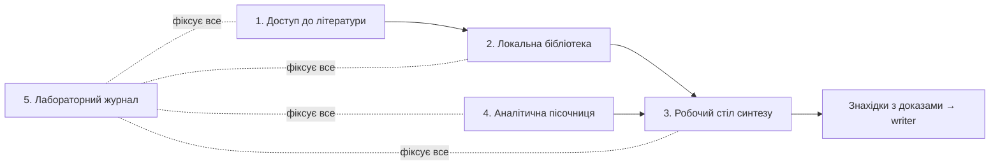

# Агент-дослідник і дослідницька лабораторія

Дата: 2026-10-28. Статус: **погоджено автором 2026-10-28** (рішення — §9). Доповнення до кроку 3 етапу 0; вимоги — FR-54…59 у `03-requirements-v0.2.md`, архітектурне рішення — ADR-020, тести — T59–T65 у `05-eval-base.md`.

**Позначки:** **[Н]** — зовнішній факт із джерелом (перевірено 2026-10-28); **[Р]** — рішення автора; **[П]** — пропозиція, деталізується в кроці 4 / Е1; **[?]** — перевірити в Е1.

---

## 1. Навіщо окремий документ

Дослідник виконує найважчу роботу: знаходить, читає, зіставляє й аналізує. Від нього залежить, чи стаття матиме власний внесок, чи буде переказом. Автор вимагає повноцінної лабораторії в MVP і її перевірки вже на тестовій статті [Р]: результати лабораторії впливають на всі наступні ітерації.

## 2. Модель

| Правило | Зміст |
|---|---|
| Рівні, а не ID | Опис ролі містить `model_tier` (`flagship` / `strong` / `fast` / `none`). Відповідність рівня конкретній моделі — у конфігу harness окремо для кожного хоста [Р] |
| Поточна відповідність (Claude Code) | `flagship` = Claude Fable 5.1 (`claude-fable-5-1`); `strong` = Claude Opus 5.5; `fast` = Claude Sonnet 5.5 / Haiku 5.5. Mythos-рівень у публічному доступі — Fable 5.1; Mythos 5.1 / Mythos Preview публічно недоступні |
| Codex | Відповідність рівнів — флагман OpenAI; задається в тому ж конфігу [?] |
| Без мовчазного пониження | Якщо модель потрібного рівня недоступна — зупинка з поясненням або явне пониження, яке записується в журнал і в run record |
| Журнал | Кожен агентний виклик записує точний model ID, дату, рівень, бюджет і фактичні витрати (або `unknown`) |

**Рівні за ролями:**

| Роль / задача | Рівень |
|---|---|
| Дослідник: план пошуку, читання, екстракція, синтез, контрдокази, вибір методу аналізу | flagship |
| Аналітик: методологія, валідність, межі висновків | flagship |
| Інтеграційний критик дисертації | flagship |
| Writer одиниці, критик одиниці, критик розділу | strong |
| Семантичні підсумки, triage релевантності, класифікація | fast |
| Схеми, hashes, tuple-валідатори, звірка цитат, обсяг, перетини | none (CLI) |

Синтаксис вибору моделі в описі субагента Claude Code і в Codex перевіряється в Е1 за документацією хоста [?].

## 3. Лабораторія: п'ять частин

### 3.1. Доступ до літератури

| Ресурс | Роль | Доступ |
|---|---|---|
| OpenAlex | **Основний** пошук, metadata, цитування, позначка OA | Працює без входу (2026-10-28): тестовий EN-запит ≈30 380 результатів, 97,6% позначено OA; API [?] ліміти |
| Crossref, Semantic Scholar | Metadata, DOI, цитування | Відкриті API [?] ліміти |
| **ERIC** | Основна база освітніх наук | Працює без входу (2026-10-28): тестовий запит — 577 результатів; фільтри «Full text available on ERIC» і «Peer reviewed only»; посилання на API є [?] |
| DOAJ, arXiv | Відкриті журнали, препринти | Відкриті API |
| Unpaywall | Легальні відкриті повні тексти за DOI | Відкритий API (потрібен email) |
| Наукова періодика України (НБУВ), сайти фахових журналів | Українська література | Працює без входу (2026-10-28): тестовий UA-запит — 27 результатів; PDF статей доступні; **пакетного експорту немає** — запис за записом (адаптер на рівні окремої картки або ручне додавання) [?] |
| Google Scholar | Додатковий пошук | Працює (2026-10-28): UA-запит ≈4 460; BibTeX для кожного запису окремо; лише вручну автором, без обходу CAPTCHA |
| Scopus | Пошук документів | **Працює (перевірка 2026-10-28):** віддалений доступ УДУ активовано, вхід особистим логіном Elsevier; тестовий запит — 343 результати; експорт RIS, ліміт 20 000 записів. Режим harness — ручний експорт RIS / CSV |
| Scopus Sources | Перевірка журналу (FR-37) | **Працює без входу**: OA, роки покриття, категорія, CiteScore, ранг; мітки active / discontinued немає — статус на дату виводиться з років покриття |
| Web of Science | Пошук документів | **Не працює (2026-10-28): вкладка Documents неактивна.** Віддалений доступ — за процедурою Clarivate (лист бібліотеки 2026-10-28):** особистий кабінет, зареєстрований з IP-адреси університету, автоматично отримує віддалений доступ на ~6 місяців, після чого вхід з приміщення УДУ потрібно повторити. Автор за кордоном → бібліотека пропонує активувати дистанційно з його логіном і паролем, після чого пароль змінюється. Строк дії фіксується в `source-policy` як `access_expires` |
| Clarivate Master Journal List | Перевірка журналу (FR-37) | **Працює без входу** для пошуку; профіль журналу — після безкоштовного входу; показує колекцію (наприклад ESCI) |
| Research4Life | Повні тексти платних журналів | **Працює (перевірка 2026-10-28):** тестовий запит — 530 результатів; повні тексти SAGE, Wiley, Springer, Taylor & Francis відкриваються; працює лише через проксі-портал `login.research4life.org/tacsgr1portal_research4life_org/` — зі звичайного portal.research4life.org посилання йдуть без проксі (SAGE не відкривається). Доступ надано через інституційний логін УДУ. За листом бібліотеки, через портал доступні платформи більшості міжнародних видавців (Springer, Wiley, Taylor & Francis, SAGE, EBSCO). Умова: логін не передається нікому, несанкціоноване використання може призвести до дискваліфікації УДУ. Тому harness **не зберігає облікові дані Research4Life і не автоматизує його**: вхід і завантаження PDF — лише автор, вручну, поштучно |
| ResearchGate | Виявлення авторських копій | Сесії немає, доступ відновлюється. API немає; лише вручну; копія звіряється з первинною версією (addendum §4) |
| Повні тексти видавців (Springer, Elsevier, Wiley, Taylor & Francis, SAGE) | Платні статті | Springer, Wiley, T&F, SAGE — **через Research4Life працюють** (2026-10-28). ScienceDirect (Elsevier) — **лише preview** навіть після активації віддаленого доступу; перевірити Elsevier-журнали через проксі Research4Life і повідомити бібліотеку [?] |
| PDF автора | Тексти з інституційного доступу | Автор кладе у `sources/inbox/`; у git не комітяться (ADR-014) |

Пошук іде за планом (FR-03, FR-20): запит, ресурс, дата, статус доступу. «Не перевірено» ≠ «нічого не знайдено». Платних викликів за замовчуванням немає (ADR-017).

**Стратегія доступу MVP (за перевіркою 2026-10-28).** Лабораторія спирається на відкритий стек: OpenAlex (основний індекс) → ERIC (освітні науки) → Crossref / Semantic Scholar (metadata) → Unpaywall / DOAJ (повні тексти OA) → НБУВ і сайти фахових журналів (українська література, PDF) → Google Scholar (ручне доповнення). Scopus Sources і MJL — для перевірки журналів. Платні повні тексти — лише після налаштування інституційного доступу. Ризик: зміщення вибірки до відкритих публікацій. Тому coverage report показує частку fulltext / abstract / metadata і окремо ключові роботи без повного тексту; claim, що спирається лише на abstract, отримує щонайбільше `insufficient` (D2).

**Ручний експорт (Scopus, WoS, Google Scholar, ResearchGate).** Агент формує пошуковий рядок під синтаксис бази і передає його автору. Автор запускає пошук у вебінтерфейсі і кладе файл експорту в `sources/inbox/`. `rh source import --from scopus|wos <файл>` імпортує записи, а search log фіксує ресурс, точний запит, дату, кількість результатів і hash файла експорту. Автоматизацію браузером не використовуємо: інституційний вхід і умови сервісів.

**Повні тексти.** Scopus і WoS — індекси, а не джерела повних текстів. Повний текст береться так: відкритий доступ (Unpaywall, DOAJ, репозиторії), PDF через підписки ЗВО у видавців (автор), авторські копії (ResearchGate, з позначкою версії).

### 3.1а. Відкриті ресурси і план адаптерів (2026-10-28)

Поки віддалений доступ УДУ до Scopus / WoS не активовано, лабораторія працює на відкритих ресурсах. Адаптер Scopus / WoS однаково буде ручним імпортом експорту, тому з появою доступу код змінювати не доведеться.

| Рівень | Ресурс | Спосіб доступу | Умови (перевірено 2026-10-28, якщо не позначено [?]) | Роль | Milestone |
|---|---|---|---|---|---|
| A — API | OpenAlex | REST API з ключем | Безкоштовний обліковий запис дає ключ; безкоштовний бюджет — $1 використання на добу, далі — передоплата [Н]. Платне вимкнено (ADR-017): при вичерпанні добового бюджету — зупинка, статус `budget_exhausted` | Основний індекс, OA-статус, цитування | M2 |
| A | ERIC | REST API | Безкоштовний [?] ліміти | Освітні науки | M2 |
| A | Crossref | REST API | Безкоштовний; «polite pool» з email [?] | DOI, metadata, оновлення, відкликання | M2 |
| A | Semantic Scholar | REST API | Безкоштовний; ключ — для вищих лімітів [?] | Цитування, зв'язки, TLDR | M2. Ключ отримано (2026-10-28); веб-пошук ~282 000 (булеві оператори, ймовірно, не підтримуються — числа не порівнювати зі Scopus) |
| A | Unpaywall | REST API | Безкоштовний, потрібен email [?] | Легальні OA-копії за DOI | M2 |
| A | CORE (core.ac.uk) | REST API | Безкоштовний без реєстрації: 1 batch або 5 одиночних запитів за 10 с; ключ — швидше; повні тексти доступні машинно; просять цитувати CORE [Н] | **Повні тексти OA з репозиторіїв** | M2. Ключ отримано (2026-10-28). Веб-пошук: запит без лапок — 3 010 результатів, з лапками — помилка сторінки; фразовий пошук через API — перевірити в Е1 [?] |
| A | DOAJ | REST API | Безкоштовний [?] | OA-журнали і статті; перевірка журналу | M2 |
| B — OAI-PMH | Українські фахові журнали на OJS, репозиторій УДУ (enpuir.udu.edu.ua), інші репозиторії ЗВО | Збір metadata через OAI-PMH конкретних журналів / репозиторіїв | Наявність endpoint у кожного — перевірити [?] | Українська література, повні тексти PDF | M3 |
| B | НРАТ (nrat.ukrintei.ua) | Пошук / експорт — перевірити [?] | — | Українські дисертації і звіти — для огляду і перевірки новизни | M3 |
| C — ручний імпорт | Google Scholar | Автор позначає записи зірочкою → My Library → Export All; підтверджено формат RefMan (RIS) [Н]; BibTeX — для окремих записів | Без обходу CAPTCHA | Доповнення, «сіра» література | M2 |
| C+ — браузерний режим (опційно) | Google Scholar через Claude in Chrome у сесії автора | Агент виконує пошук у браузері автора людським темпом; лише для локального використання автором | Рішення автора 2026-10-28; запобіжники — нижче | Прискорення пошуку в Scholar | M2 (за умови, що Claude in Chrome доступний з Claude Code [?]) |
| C | Zotero (опційно) | Автор збирає записи конектором з будь-якого сайту → експорт BibTeX / RIS | — | Універсальний міст для сайтів без API | M2 |
| C | Наукова періодика України (НБУВ) | Запис за записом: картка + PDF | Пакетного експорту немає (перевірка 2026-10-28) | Українська література | M2 |
| C | Scopus, WoS | Експорт RIS / CSV після активації віддаленого доступу УДУ | — | Повний пошук | M2 (адаптер), фактично — після доступу |
| D — перевірка журналів | Scopus Sources, Clarivate MJL, DOAJ, Перелік наукових фахових видань України | Вручну або сторінкою джерела; запис доказу з датою (FR-37) | Перелік — перевірити спосіб доступу [?] | Статус журналу на дату | M2–M3 |

**Браузерний режим Google Scholar — запобіжники (рішення автора 2026-10-28).** Автор усвідомлює, що автоматизовані запити до Google Scholar суперечать умовам сервісу, і приймає ризик для власного локального використання.
1. Вимкнено за замовчуванням; вмикається лише прапорцем у локальному конфігу автора (`source-policy.local.yaml`, поза git); у дистрибутив harness для інших користувачів увімкненим не потрапляє.
2. Людський темп: ліміт запитів на сесію і паузи між запитами (значення — у конфігу).
3. CAPTCHA або сторінка блокування → негайна зупинка, статус `blocked`, передача автору; без розв'язування й обходу.
4. Кожен запис зі Scholar звіряється з OpenAlex / Crossref перед імпортом; без збігу — `metadata_status: unverified`.
5. Search log: ресурс `google_scholar (browser-assisted)`, запит, дата, кількість переглянутих записів.
6. Лише Google Scholar. Для Scopus / WoS (ліцензія УДУ) браузерна автоматизація не застосовується — лише ручний експорт.

**Кандидати на перевірку в Е1 [?]:** EdArXiv / OSF Preprints (освітні препринти), Zenodo, BASE, Lens.org.

**Секрети.** Ключі OpenAlex, CORE, Semantic Scholar і email для Unpaywall / Crossref зберігаються лише у змінних середовища або локальному файлі поза git (NFR-06, ADR-014); `source-policy.yaml` містить тільки назви змінних.

### 3.2. Локальна бібліотека

- Кожне джерело: metadata, рівень доступу (fulltext / abstract / metadata), ліцензія, hash оригіналу, текст із **номерами сторінок** і розміткою розділів.
- Locator зберігає **дві нумерації**: сторінку файла PDF і друковану сторінку видання (наприклад, у тестовій статті SAGE через Research4Life PDF-сторінка 1 = с. 592 журналу). У посиланнях і цитатах використовується друкована сторінка; зсув визначається з metadata (SP / EP) або колонтитулів.
- Експорт зі Scopus за замовчуванням не містить анотацій і ключових слів (тестовий RIS 2026-10-28). Імпорт збагачує записи за DOI через OpenAlex / Crossref; в інструкції для автора — обирати в експорті Scopus поля «Abstract & keywords».
- Локальний повнотекстовий індекс (SQLite FTS5 або tantivy [П]) по всіх прочитаних джерелах проєкту.
- **Детермінована звірка цитат:** кожна пряма цитата і кожен excerpt перевіряються проти тексту джерела на вказаній сторінці; розбіжність — finding (D6, D12).
- Дедуплікація і зв'язок «препринт ↔ публікація» (реєстр reuse #32); перевірка відкликаних статей (#17).

### 3.3. Робочий стіл синтезу

| Інструмент | Що робить |
|---|---|
| Матриця екстракції | Джерело × дослідницькі питання: що стверджує, на яких даних, з якими обмеженнями, де (locator) |
| Карта позицій | Згрупування джерел за позиціями; хто з ким сперечається |
| Прогалини | Питання, на які матриця не має відповіді, з evidence refs |
| Контрдокази | Для кожного центрального твердження — цілеспрямований пошук протилежних даних; результат «не знайдено» записується з переліком запитів |
| Насичення | Критерій зупинки: N нових джерел поспіль не додають нових тем чи позицій (N — у протоколі) |
| Бібліометрія корпусу | Мапи співвживання ключових слів, кластери тем, часова динаміка — скриптами в пісочниці |

### 3.4. Аналітична пісочниця

| Властивість | Зміст |
|---|---|
| Середовище | Ізольоване Python-оточення проєкту: `uv` + lockfile; Docker — опційно [П]. Базові пакети: pandas, numpy, scipy, statsmodels, matplotlib; для тексту — бібліотеки токенізації з підтримкою української [?] |
| Мережа | За замовчуванням вимкнена під час аналізу; дозволені лише завантаження зареєстрованих датасетів на етапі імпорту |
| Реєстр датасетів | Назва, версія, URL, ліцензія / умови використання, дата завантаження, hash, опис змінних. Кандидати: PISA, TALIS, TIMSS / PIRLS (OECD / IEA), UNESCO UIS, відкриті дані УЦОЯО (НМТ / ЗНО), портал data.gov.ua [?] умови кожного |
| Аналіз | Кожен аналіз — скрипт у `analysis/` + hash даних + lockfile; запуск через `rh analysis run`; результат — result rows з повним tuple (dataset, вибірка, змінна / метрика, unit, aggregation, ваги) |
| Числа в тексті | Будь-яке число з аналізу в тексті прив'язане до result row; перевірка — tuple-валідатори (ADR-009, FR-06) |
| Графіки | Лише з result rows кодом (FR-18); зміна даних інвалідує графік і claims |
| Якісний аналіз документів | Кодування публічних документів (освітні програми, стандарти, політики щодо ШІ в ЗВО): codebook, коди з locator, частоти; кожна цитата — зі звіркою |
| Типи run | executed / imported / failed; `simulated` дозволений лише для пілотування інструменту і ніколи не підтверджує результат (FR-05) |

### 3.5. Лабораторний журнал

Хронологічний запис кожної дослідницької задачі: питання, гіпотези, план, запити, рішення включення / виключення, глухі кути, відхилення від протоколу, витрати, model ID. Журнал — частина історії статті і доказ процесу роботи автора (FR-53, FR-34).

## 4. Дослідницький цикл

| Крок | Хто | Вихід | Перевірка |
|---|---|---|---|
| 1. Питання і межі | Автор + дослідник | Research question, межі | Л — автор погоджує |
| 2. План пошуку | Дослідник | Ресурси, запити, критерії включення, критерій насичення, бюджет | Д — повнота плану |
| 3. Пошук | Дослідник | Search log, кандидати | Д — журнал, статуси доступу |
| 4. Читання й екстракція | Дослідник | Excerpts з locator, матриця | Д — звірка цитат |
| 5. Синтез і прогалини | Дослідник | Карта позицій, прогалини | С — критик |
| 6. Контрдокази | Дослідник | Контрпозиції для центральних тверджень | Д — кожне центральне твердження має запис пошуку контрдоказів |
| 7. Аналіз даних (за потреби) | Дослідник + аналітик | Скрипти, result rows, графіки | Д — відтворюваність, tuple; С — аналітик (метод, межі) |
| 8. Знахідки | Дослідник | Findings з evidence refs → writer | С — критик; Л — автор приймає ключову інтерпретацію |

Зупинка: насичення, бюджет або рішення автора. Нескінченного пошуку немає: кожен цикл має ліміт, вичерпання — звіт з тим, що не покрито.

## 5. Межі

1. **Без симуляції учасників.** Синтетичні респонденти, інтерв'ю чи «опитування» моделі не є даними дослідження. Допускається лише пілотування інструменту (чи зрозумілі питання анкети) з позначкою `simulated`; такий run не може підтверджувати claim (FR-59).
2. **Без людей — без GE.** Автор зараз не має часу на дослідження з учасниками [Р]. Лабораторія MVP покриває: огляд, концептуальний аналіз, вторинний аналіз відкритих даних, аналіз документів, бібліометрію. Емпіричні дослідження з учасниками — коли автор матиме час; тоді діє GE (FR-31). Чи потрібне етичне рішення для вторинного аналізу анонімізованих відкритих даних — визначає положення ЗВО [?].
3. **Умови використання даних.** Датасет без зафіксованих умов використання не потрапляє в аналіз.
4. **Доступ — лише легальний.** Без обходу paywall, CAPTCHA чи умов сервісів; повні тексти — відкриті, через ЗВО або від автора.

## 6. Критик з іншої родини моделей (опційно)

**Як це працює з Claude CLI.** Harness — це звичайна програма `rh`, яку агент запускає в терміналі (як `git`). Команда `rh review --engine codex <пакет>` запускає Codex CLI у неінтерактивному режимі як окремий процес: передає йому контекстний пакет рецензії (файли) і чекає findings у JSON за тією ж схемою, що й у Claude-критика. Результат записується в `reviews/` поруч з іншими. Точна команда неінтерактивного запуску Codex перевіряється в Е1 [?].

| Умова | Наслідок |
|---|---|
| Потрібні окремі облікові дані (вхід у Codex через підписку OpenAI або API-ключ) | Без них — статус `unavailable`, fallback на Claude-критика в свіжому контексті; не помилка |
| Текст іде до іншого провайдера | Дозволено лише якщо в intake (Q3b) дозволено передавати матеріали зовнішнім API |
| Витрати | Окремий бюджет; за замовчуванням вимкнено (ADR-017) |
| Користь | Міряє пілот C (M5): Claude-критик проти Codex-критика на тих самих F4-W і F7 |

Якщо підписки OpenAI немає, функція просто лишається вимкненою; решта системи від неї не залежить.

## 7. Як міряємо якість дослідника

| Тест | Що перевіряє |
|---|---|
| T59 | Пошук у ≥3 адаптерах із журналом; бібліотека з номерами сторінок; звірка цитат ловить вигадану й неточну цитату |
| T60 | Recall ключових робіт підтеми F4 (список автора); наявність контрпозицій для центральних тверджень |
| T61 | Зупинка за насиченням і бюджетом записана; звіт про непокрите |
| T62 | Аналіз відкритого датасету відтворюється з нуля з тими самими result rows; зміна даних → stale; мережа вимкнена |
| T63 | Рівні моделей: недоступний flagship → зупинка або записане пониження; model ID у журналі |
| T64 | Codex-критик: без облікових даних — `unavailable` і fallback; без дозволу Q3b — виклик заблоковано; з ними — findings у спільній схемі |
| T65 | Спроба використати синтетичних респондентів як дані → blocker |

Деталі — `05-eval-base.md` §7.

## 8. Milestones

| Частина | Milestone |
|---|---|
| Рівні моделей і журнал викликів | M1 (конфіг), M2 (використання) |
| Доступ до літератури, локальна бібліотека, звірка цитат, робочий стіл синтезу, журнал | M2 |
| Аналітична пісочниця, реєстр датасетів, tuple-валідатори, графіки з даних, якісне кодування документів | M3 |
| Codex-критик (опційно) | M3; порівняння — M5 |
| Повна лабораторія на тестовій статті автора | M5 (пілот) |
| ML-експерименти (тренування моделей, seeds-протоколи) | M6 |

Наслідок: tuple-валідатори, розрізнення типів run і графіки з даних (FR-05, 06, 18) переходять з M6 у M3 — вони потрібні для аналізу відкритих освітніх даних, а не лише для ML.

## 9. Рішення

| Дата | Рішення |
|---|---|
| 2026-10-28 | Флагманська модель для дослідника, аналітика й інтеграційного критика; в описах ролей — рівень моделі, відповідність — у конфігу |
| 2026-10-28 | Повноцінна лабораторія (5 частин) — у MVP; перевірка на тестовій статті |
| 2026-10-28 | Типи досліджень — усі; через брак часу на залучення людей MVP-лабораторія охоплює огляд, концептуальний аналіз, вторинний аналіз відкритих даних, аналіз документів, бібліометрію |
| 2026-10-28 | Аналітична пісочниця — MVP (M3) |
| 2026-10-28 | Інституційний доступ до баз — автор з'ясовує |
| 2026-10-28 | Codex-критик — пробуємо в пілоті як опційну функцію |
| 2026-10-28 | Браузерний режим Google Scholar через Claude in Chrome — опційний, лише для локального використання автором, із запобіжниками §3.1а; ризик щодо умов сервісу приймає автор |
| 2026-10-28 | Ключі API (OpenAlex та інші) — лише у змінних середовища поза git; у документах і конфігах harness — тільки назви змінних |

## 10. Відкрите для автора

| # | Питання | Стан (перевірка в браузері 2026-10-28) |
|---|---|---|
| 1 | Scopus і ScienceDirect | Scopus працює; ScienceDirect — лише preview: перевірити через Research4Life, повідомити бібліотеку |
| 2 | Web of Science | Потрібна дистанційна активація бібліотекою (див. рядок WoS у §3.1); строк ~6 місяців |
| 3 | ЗВО і бібліотека | **УДУ імені Михайла Драгоманова** (автор, 2026-10-28). За сайтом Наукової бібліотеки [Н]: на 2026 р. доступні Scopus, Web of Science, ScienceDirect, Research4Life — з IP-адрес бібліотеки (читальні зали, вул. Пирогова, 9 і Кониського, 8/14); віддалений доступ активується за запитом на lib@udu.edu.ua; ресурси EIFL (Cambridge, Oxford, ACM, IOP тощо) — в університетській мережі. Springer, Wiley, EBSCO на сторінках не згадуються. **Дія автора:** запит на віддалений доступ (автор перебуває за кордоном) |
| 4 | Повні тексти видавців | Немає з поточного браузера |
| 5 | Research4Life | Доступ надано 2026-10-28 (інституційний логін УДУ) |
| 6 | ResearchGate | Відновлення доступу |
| 7 | Підписка OpenAI / ChatGPT для Codex-критика | Не з'ясовано |

Перевірку виконано через Claude in Chrome за промптом цього чату; результати — у файлі автора `naukovi_resursy_dostup.xlsx` (2026-10-28). Висновки з позначкою «припускаю» у файлі тут не використані як факти.

## Джерела

- Вишам продовжили безоплатний доступ до Scopus та WoS у 2026 році — osvita.ua: https://osvita.ua/vnz/96086/ (перевірено 2026-10-28)
- Ukrainian educational and scientific institutions will have free access to Scopus and Web of Science in 2026 — Lviv Polytechnic: https://lpnu.ua/en/news/ukrainian-educational-and-scientific-institutions-will-have-free-access-scopus-and-web-science
- МОН: українські заклади освіти і науки матимуть безоплатний доступ до Scopus та WoS у 2026 році: https://mon.gov.ua/news/ukrainski-zaklady-osvity-i-nauky-matymut-bezoplatnyi-dostup-do-scopus-ta-wos-u-2026-rotsi
- Наукова бібліотека УДУ імені Михайла Драгоманова — «Нові наукові горизонти у новому 2026 році» (25.12.2025): https://lib.udu.edu.ua/novyny/novi-naukovi-horyzonty-u-novomu-2026-rotsi (перевірено 2026-10-28)
- Наукова бібліотека УДУ — сторінка «Науковцю»: https://lib.udu.edu.ua/naukovtsiu (перевірено 2026-10-28)
- OpenAlex Pricing Overview: https://help.openalex.org/access/pricing/ (перевірено 2026-10-28)
- CORE API: https://core.ac.uk/services/api (перевірено 2026-10-28)
- Rush University Library — Google Scholar: export citations (My Library → Export All, RefMan): https://library.rush.edu/google-scholar-help/export-citations (перевірено 2026-10-28)
